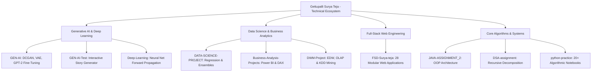

<p align="center">
  
</p>

<p align="center">
  
  
  
  
  
</p>

---

## Executive Summary / Overview
### Problem Statement & Context
Recruiters and engineering leaders seeking elite talent need demonstrable evidence of end-to-end technical mastery—from fundamental algorithmic problem-solving and software design patterns to deep generative artificial intelligence and enterprise data warehousing.

### Solution Overview
I am **Gettupalli Surya Teja**, a forward-thinking Software Engineer specializing in **Generative AI, Data Science, and Scalable Full-Stack Engineering**. This repository serves as the **Master Portfolio Index** connecting all 24 repositories across my GitHub profile, demonstrating end-to-end engineering competence from low-level data structures and algorithmic complexity to production machine learning deployments.

---

## Interactive Table of Contents
- [Executive Summary / Overview](#executive-summary--overview)
- [Key Features & Capabilities](#key-features--capabilities)
- [System Architecture / Pipeline](#system-architecture--pipeline)
- [Tech Stack Breakdown](#tech-stack-breakdown)
- [Reproducible Quickstart & Setup](#reproducible-quickstart--setup)
- [Project Directory Layout](#project-directory-layout)
- [Author & Contributions](#author--contributions)

---

## Key Features & Capabilities
- **Generative AI & LLMs:** Hands-on implementations of DCGANs on Fashion-MNIST, VAEs on MNIST, and GPT-2 fine-tuning / interactive story generation.
- **Data Science & Analytics:** Multi-model regression pipelines, feature engineering, and executive Power BI scorecards with advanced DAX metrics.
- **Enterprise Warehousing & Mining:** Deep technical foundation in Star/Snowflake schemas, OLAP hypercube operations, and Apriori association mining.
- **Full-Stack Web Engineering:** 28 modular web applications showcasing semantic HTML5, CSS3 Grid/Flexbox, and vanilla ES6+ DOM manipulation.
- **Core Algorithms & OOP:** Rigorous mastery of Java Object-Oriented design, recursive algorithmic decomposition, and Python data structure optimizations.

---

## System Architecture / Pipeline


---

## Tech Stack Breakdown
| Layer | Technology | Details |
| :--- | :--- | :--- |
| **Languages** | Python, Java, JavaScript (ES6+), SQL, DAX, HTML5, CSS3 | Multi-paradigm development suite |
| **Libraries** | PyTorch, TensorFlow, Hugging Face, Scikit-Learn, Pandas, NumPy | Machine learning and analytical data processing |
| **Tools** | Microsoft Power BI, Git, GitHub CLI, Jupyter Lab, VS Code | DevOps, visualization, and IDE environments |
| **Architecture** | Microservices, OOP, Generative Deep Learning, Dimensional EDW | Scalable systems and algorithmic design |

---

## Reproducible Quickstart & Setup
```bash
# Explore Surya's Flagship Repositories:

# 1. Generative AI Lab
git clone https://github.com/suryateja-155/GEN-AI.git

# 2. Applied Data Science Pipeline
git clone https://github.com/suryateja-155/DATA-SCIENCE-PROJECT.git

# 3. Enterprise Business Analytics
git clone https://github.com/suryateja-155/Business-Analysis-Projects.git

# 4. Full-Stack Web Development Lab
git clone https://github.com/suryateja-155/FSD-Surya-teja.git
```

---

## Project Directory Layout
```text
Portfolio-Ecosystem/
├── GEN-AI/                     # Generative AI research (DCGAN, VAE, GPT-2)
├── GEN-AI-Test/                # Interactive story generator with Gradio UI
├── DATA-SCIENCE-PROJECT/       # Machine learning regression & statistical pipeline
├── Business-Analysis-Projects/ # Enterprise Power BI dashboards & DAX models
├── DWM-Project/                # Data warehousing, OLAP cubes & data mining
├── FSD-Surya-teja/             # 28 responsive frontend & web app modules
├── JAVA-ASSIGNMENT_2/          # Java OOP architecture & inheritance hierarchies
├── DSA-assignment/             # Recursion mechanics & divide-and-conquer
└── python-practice/            # 20+ algorithmic & data structure notebooks
```

---

## Author & Contributions

**Gettupalli Surya Teja**  
- GitHub Profile: [@suryateja-155](https://github.com/suryateja-155)  
- Portfolio Index: [Gettupalli-Surya-Teja](https://github.com/suryateja-155/Gettupalli-Surya-Teja)

Contributions, issue reports, and feedback are always welcome! Feel free to open an issue or pull request.

<p align="center">
  
</p>
